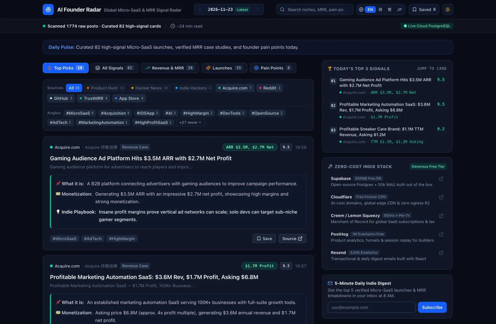
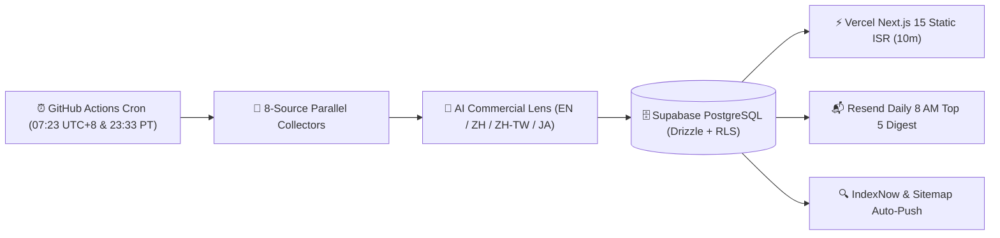

<div align="center">
  <h1>AI Founder Radar</h1>
  <p><strong>5-minute daily intelligence on Micro-SaaS launches, verified MRR case studies, and high-intent user pain points.</strong></p>

  <p>
    <a href="https://radar.aibuildon.com"><strong>Live Radar</strong></a> ·
    <a href="https://radar.aibuildon.com/en">English</a> ·
    <a href="https://radar.aibuildon.com/zh">简体中文</a> ·
    <a href="https://radar.aibuildon.com/zh-TW">繁體中文</a> ·
    <a href="https://radar.aibuildon.com/ja">日本語</a>
  </p>

  <p>
    <a href="https://radar.aibuildon.com"></a>
    <a href="https://github.com/wuyexiong/ai-founder-radar/actions/workflows/radar-cron.yml"></a>
    
    
    <a href="./LICENSE"></a>
  </p>

  <p>
    <strong>English</strong> | <a href="./README.zh-CN.md">简体中文</a>
  </p>
</div>

<br />

<a href="https://radar.aibuildon.com">
  
</a>

---

## Why AI Founder Radar?

Most AI newsletters drown solo builders in big-tech press releases, funding announcements, and LLM benchmark tables. **AI Founder Radar** is engineered strictly for Indie Hackers, solo founders, and product builders looking for validated demand and replicable monetization:

1. **Zero Benchmark Fluff, Pure Commercial Signal** — Automatically filters out toy demos, unmonetized hobby repos, and big-tech incumbents to surface only profitable Micro-SaaS tools, breakout subscription apps, and high-intent user complaints.
2. **3-Second Structured Founder Lens** — Every raw overseas post is distilled into three scannable commercial dimensions:
   - `📌 What it is`: Crisp 1-sentence breakdown of target user and exact problem solved.
   - `💵 Monetization`: Verified `$MRR` / `$ARR`, pricing tier, acquisition wedge, or valuation multiple.
   - `💡 Indie Playbook`: Actionable takeaway — replicable niche angle, unbundling opportunity, or localization moat.
3. **Native 4-Language SEO & AI-Ready Archives** — Published simultaneously in **English (`en`)**, **Simplified Chinese (`zh`)**, **Traditional Chinese (`zh-TW`)**, and **Japanese (`ja`)**, with permanent static daily routes (`/[locale]/daily/YYYY-MM-DD`), full `hreflang` matrices, Schema.org `ItemList` JSON-LD, and automated IndexNow search indexing.

---

## 8 Primary Signal Sources

Twice daily (`07:23 UTC+8` morning briefing + `23:33 PT` US late-night pre-reset supplement), the collector pipeline scans 8 complementary overseas ecosystems in parallel, deduplicates against historical and same-day URLs, and scores commercial viability (`1.0–10.0`):

| Source | Signal Category | Collection Method | Commercial Focus |
| :--- | :--- | :--- | :--- |
| **TrustMRR** | Verified Revenue | Public Leaderboard & Listings | Stripe / Polar / RevenueCat payment-verified `$MRR` & SaaS-for-sale multiples |
| **App Store (US & JP)** | Mobile IAP Winners | Official iTunes Top Grossing JSON | Top Grossing Productivity (`6007`) & Utilities (`6002`), big-tech filtered out |
| **Product Hunt** | New Launches | Official Atom / RSS Feed | High-upvote daily SaaS, workflow automation, and vertical AI launches |
| **Hacker News (`Show HN`)** | Developer MVPs | HN Algolia Search API | High-engagement developer tools and commercializable solo builds |
| **GitHub Trending & Breakouts** | Open-Source Wedges | Daily Trending + GitHub Search API | Daily surging repos + newly created (`<7d`) high-star permissive-license AI tools |
| **Indie Hackers** | Revenue Stories | Community Feed Extraction | Bootstrap `$MRR` milestones, SEO/cold-outreach post-mortems, and pricing experiments |
| **Acquire.com** | SaaS Valuations | Public Marketplace Listings | Profitable Micro-SaaS ARR, profit margins, and asking multiples |
| **Reddit** | User Pain Points | `r/SaaS`, `r/microsaas`, `r/SomebodyMakeThis` | Pricing backlash, incumbent churn, and *"I'd pay for X"* demand signals |

---

## Automated Zero-Cost Architecture



### Tech Stack & Cloud Services

- **Framework**: [Next.js 15](https://nextjs.org/) (App Router, Static ISR, Edge Middleware i18n, Dynamic `next/og` Images) + [React 19](https://react.dev/) + [TypeScript](https://www.typescriptlang.org/)
- **UI & Typography**: [Tailwind CSS v4](https://tailwindcss.com/) + [Lucide Icons](https://lucide.dev/) — Editorial Light/Dark themes, `tabular-nums` financial metrics, `⌘K` instant filter, local bookmarks
- **Database & Security**: [Supabase](https://supabase.com/) PostgreSQL (Transaction Pooler compatible, Row-Level Security enabled on all tables) + [Drizzle ORM](https://orm.drizzle.team/) — graceful automatic fallback to [`local-signals.json`](./src/data/local-signals.json) when offline
- **AI Distillation Engine**: Multi-provider fallback supporting [Google Gemini API](https://ai.google.dev/) (free-tier Flash-Lite / Flash rotation), OpenAI-compatible endpoints (DeepSeek / SiliconFlow), or local Apple Silicon **Rapid-MLX / Ollama** + `opencc-js` (`cn -> twp`)
- **Hosting & Analytics**: [Vercel](https://vercel.com/) (Fluid Compute, CSP & HSTS security headers, Vercel Web Analytics) + optional PostHog, GA4, and Microsoft Clarity hooks
- **Automation & Growth**: [GitHub Actions](https://github.com/features/actions) (zero-cost daily scheduled sync) + [Resend](https://resend.com/) (localized daily email briefing & RFC 8058 one-click unsubscribe) + [IndexNow](https://www.indexnow.org/) & Google Search Console

---

## Getting Started in 5 Minutes

### One-Click Cloud Deploy

[](https://vercel.com/new/clone?repository-url=https%3A%2F%2Fgithub.com%2Fwuyexiong%2Fai-founder-radar&env=DATABASE_URL&project-name=ai-founder-radar&repository-name=ai-founder-radar)

### Local Development

**1. Zero-Config Preview (Works immediately with zero API keys)**

```bash
git clone https://github.com/wuyexiong/ai-founder-radar.git
cd ai-founder-radar
npm install
npm run dev
```

Open `http://localhost:3000` — when `DATABASE_URL` is empty, the app automatically renders the built-in curated multilingual dataset ([`src/data/local-signals.json`](./src/data/local-signals.json)).

**2. Connect Cloud PostgreSQL & Run Live AI Sync**

```bash
cp .env.example .env.local
# Fill in DATABASE_URL and GEMINI_API_KEY (or LLM_API_KEY / local MLX) in .env.local

npm run db:push         # Push Drizzle schema (with RLS) to Supabase PostgreSQL
npm run radar:sync      # Fetch 8 global sources, distill in 4 languages & push to DB
npm run radar:backfill  # Backfill missing en / zh-TW / ja fields for historical rows
```

### Environment Variables

| Variable | Target | Required | Description |
| :--- | :--- | :---: | :--- |
| `DATABASE_URL` | Vercel + GitHub Actions | **Yes** | Supabase / Neon PostgreSQL connection string (Pooler `6543` supported) |
| `GEMINI_API_KEY` | GitHub Actions / Local | **Yes*** | Google AI Studio key for daily distillation (*or use `LLM_API_KEY` / local MLX) |
| `LLM_API_KEY` / `LLM_BASE_URL` | GitHub Actions / Local | No | OpenAI-compatible fallback provider (e.g., DeepSeek, SiliconFlow) |
| `NEXT_PUBLIC_SITE_URL` | Vercel | Recommended | Canonical production origin (e.g., `https://radar.aibuildon.com`) |
| `RESEND_API_KEY` | Vercel + GitHub Actions | No | Enables welcome emails & daily 8 AM localized Top 5 newsletter delivery |
| `RESEND_FROM_EMAIL` | Vercel + GitHub Actions | No | Verified sender address (defaults to `AI Founder Radar <digest@...>`) |
| `REDDIT_CLIENT_ID` / `SECRET` | GitHub Actions / Local | No | Optional Reddit OAuth credentials (defaults to zero-auth mirror feed) |
| `NEXT_PUBLIC_POSTHOG_KEY` | Vercel | No | Optional PostHog / `NEXT_PUBLIC_GA_ID` / `NEXT_PUBLIC_CLARITY_ID` analytics |

> **Automated Daily Updates**: Add `DATABASE_URL` and `GEMINI_API_KEY` to your repository's **Settings → Secrets and variables → Actions**. [`.github/workflows/radar-cron.yml`](./.github/workflows/radar-cron.yml) runs automatically twice daily at `07:23 UTC+8` and `23:23 America/Los_Angeles` (DST-aware, backed by hourly quota-safe reconciliation & Vercel Cron watchdog).

---

## License

Distributed under the [MIT License](./LICENSE).
