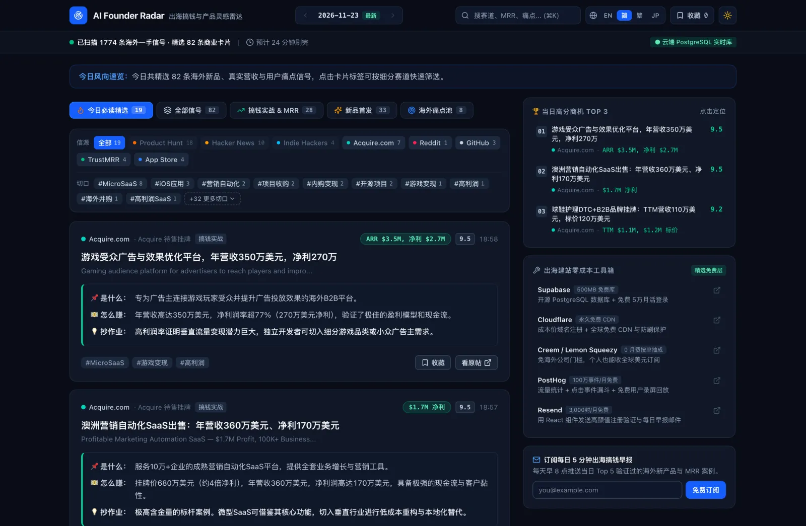
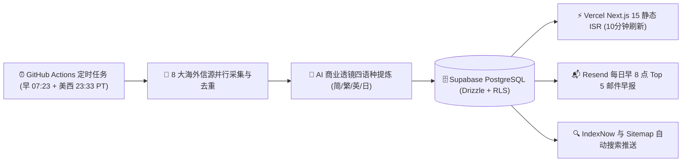

<div align="center">
  <h1>AI Founder Radar</h1>
  <p><strong>每天 5 分钟，一站式获取全球出海、AI、Micro-SaaS 与独立 App 的新品趋势、真实 MRR 营收拆解与海外用户痛点。</strong></p>

  <p>
    <a href="https://radar.aibuildon.com"><strong>在线访问看板</strong></a> ·
    <a href="https://radar.aibuildon.com/zh">简体中文</a> ·
    <a href="https://radar.aibuildon.com/zh-TW">繁體中文</a> ·
    <a href="https://radar.aibuildon.com/en">English</a> ·
    <a href="https://radar.aibuildon.com/ja">日本語</a>
  </p>

  <p>
    <a href="https://radar.aibuildon.com"></a>
    <a href="https://github.com/wuyexiong/ai-founder-radar/actions/workflows/radar-cron.yml"></a>
    
    
    <a href="./LICENSE"></a>
  </p>

  <p>
    <a href="./README.md">English</a> | <strong>简体中文</strong>
  </p>
</div>

<br />

<a href="https://radar.aibuildon.com/zh">
  
</a>

---

## 为什么做 AI Founder Radar？

市面上的大多数 AI 早报充斥着大厂融资通稿与大模型跑分参数，对真正想做产品变现的独立开发者（Indie Hacker）和一人公司创业者参考价值有限。**AI Founder Radar** 专为出海实战打造：

1. **拒绝参数水文，只筛真实商业信号** — 自动剔除大厂常青树 App、无商业模式的纯玩具 Demo 与社区水贴，聚焦单人可复制的 Micro-SaaS、高内购增长移动应用与高付费意愿痛点。
2. **固定「商业三要素」3 秒扫读结构** — 每条海外一手动态均由大模型清洗去重，严格提炼为三行高密度情报：
   - `📌 是什么`：一句话讲清目标人群与解决的具体痛点场景；
   - `💵 怎么赚`：提取实名验证 `$MRR` / `$ARR`、定价策略、SEO/社媒获客渠道或挂牌估值倍数；
   - `💡 抄作业`：独立开发者可切入的细分微创新切口、本地化机会或避坑提示。
3. **原生英 / 简 / 繁 / 日四语种与静态归档 SEO** — 内置 `/en`、`/zh`、`/zh-TW`、`/ja` 及永久静态历史归档路由（`/[locale]/daily/YYYY-MM-DD`），配齐 `hreflang` 多语言矩阵、Schema.org `ItemList` 结构化数据与 IndexNow 自动搜索引擎推送。

---

## 8 大海外一手商业信源矩阵

每天两次（北京时间早盘 `07:23` + 美西深夜 `23:33 PT` 结榜前夕补采），采集管线并行扫描以下 8 大海外一手渠道，完成跨日及同日增量 URL 防重与商业参考价值打分（`1.0 ~ 10.0`，低于 `6.3` 自动淘汰）：

| 信源平台 | 信号类型 | 采集方式 | 核心商业看点 |
| :--- | :--- | :--- | :--- |
| **TrustMRR** | 实名验证营收 | 公开榜单与在售项目提取 | Stripe / Polar / RevenueCat 官方流水验证的真实 `$MRR` 与 SaaS 挂牌叫价倍数 |
| **App Store（美区 & 日区）** | 出海内购黑马 | Apple iTunes 畅销榜 JSON | 美/日区效率榜（`6007`）与工具榜（`6002`）畅销排行，自动过滤大厂，专挖订阅制独立黑马 |
| **Product Hunt** | 每日新品首发 | 官方 Atom / RSS 源 | 当日高票 SaaS 工具、自动化工作流与垂直场景 AI 新品 |
| **Hacker News (`Show HN`)** | 极客早期产品 | HN Algolia 官方检索接口 | 具备产品化与变现潜力的开发者原创工具与高热度早期 MVP |
| **GitHub Trending + 7 日新锐** | 开源商业化切口 | 每日飙升榜 + Search API | 当日飙升仓库 + 近 7 天新诞生的高星宽松协议（MIT/Apache）AI 与效率工具 |
| **Indie Hackers** | 实战变现复盘 | 社区热门帖提取 | 独立开发者从 0 到 `$10k+ MRR` 的冷启动获客拆解、定价实验与踩坑复盘 |
| **Acquire.com** | 盈利项目估值 | 公开挂牌精选 | 已盈利微型 SaaS 的年化营收（ARR）、净利润率与出售估值倍数 |
| **Reddit 创业与许愿版块** | 海外痛点许愿池 | `r/SaaS`、`r/microsaas`、`r/SomebodyMakeThis` | 海外真实用户吐槽现有软件涨价/难用、明确求付费平替的高意向痛点信号 |

---

## 零成本全自动系统架构



### 技术栈与云服务清单

- **全栈框架**：[Next.js 15](https://nextjs.org/)（App Router、Static ISR 静态增量再生、Edge Middleware 多语言自动跳转、动态 `next/og` 分享图）+ [React 19](https://react.dev/) + [TypeScript](https://www.typescriptlang.org/)
- **界面与排版**：[Tailwind CSS v4](https://tailwindcss.com/) + [Lucide Icons](https://lucide.dev/) — 编辑部极简风浅色/深色双主题、`tabular-nums` 等宽商业数字、`⌘K` 全局搜索、浏览器本地书签收藏夹
- **数据库与安全**：[Supabase](https://supabase.com/) PostgreSQL（兼容 Transaction Pooler 连接池，全表开启 RLS 行级安全）+ [Drizzle ORM](https://orm.drizzle.team/) — 未配置数据库时自动平滑降级至本地样本库 [`local-signals.json`](./src/data/local-signals.json)
- **AI 提炼引擎**：支持 [Google Gemini API](https://ai.google.dev/)（免费额度 Flash-Lite / Flash 轮换）、OpenAI 兼容接口（DeepSeek / 硅基流动），或本机 Apple Silicon **Rapid-MLX / Ollama** 本地大模型 + `opencc-js` 台湾正体字词转换
- **托管与统计**：[Vercel](https://vercel.com/)（Fluid Compute、严格 CSP/HSTS 安全响应头、Vercel Web Analytics）+ 预留 PostHog、GA4、Microsoft Clarity 环境变量开关
- **自动化与增长**：[GitHub Actions](https://github.com/features/actions)（每日定时免服务器采集保活）+ [Resend](https://resend.com/)（按读者语言定制每日早报与 RFC 8058 一键退订）+ [IndexNow](https://www.indexnow.org/) & Google Search Console

---

## 5 分钟本地启动与一键部署

### 云端一键部署

[](https://vercel.com/new/clone?repository-url=https%3A%2F%2Fgithub.com%2Fwuyexiong%2Fai-founder-radar&env=DATABASE_URL&project-name=ai-founder-radar&repository-name=ai-founder-radar)

### 本地开发运行

**阶段 1：零配置开箱预览（无需申请任何数据库或 API Key）**

```bash
git clone https://github.com/wuyexiong/ai-founder-radar.git
cd ai-founder-radar
npm install
npm run dev
```

浏览器打开 `http://localhost:3000` —— 当未配置 `DATABASE_URL` 时，系统会自动降级读取内置的四语种精选样本数据（[`src/data/local-signals.json`](./src/data/local-signals.json)）。

**阶段 2：接入云端数据库并执行实时采集**

```bash
cp .env.example .env.local
# 在 .env.local 中填入 DATABASE_URL 与 GEMINI_API_KEY（或 LLM_API_KEY / 本地 MLX）

npm run db:push         # 将 Drizzle 表结构（含 RLS 策略）推送至 Supabase PostgreSQL
npm run radar:sync      # 抓取 8 大海外信源，执行四语种商业提炼并入库
npm run radar:backfill  # 为数据库早期历史记录自动补全英 / 繁 / 日翻译字段
```

### 环境变量速查表

| 变量名 | 部署位置 | 必填 | 用途说明 |
| :--- | :--- | :---: | :--- |
| `DATABASE_URL` | Vercel + GitHub Actions | **是** | Supabase / Neon PostgreSQL 连接串（支持 `6543` Pooler 端口） |
| `GEMINI_API_KEY` | GitHub Actions / 本地 | **是*** | Google AI Studio 免费密钥（*也可改填 `LLM_API_KEY` 或走本机 MLX） |
| `LLM_API_KEY` / `LLM_BASE_URL` | GitHub Actions / 本地 | 否 | 兼容 OpenAI 格式的备选大模型（如 DeepSeek、SiliconFlow） |
| `NEXT_PUBLIC_SITE_URL` | Vercel | 推荐 | 正式站点根域名（如 `https://radar.aibuildon.com`），用于生成 Sitemap 与 Canonical |
| `RESEND_API_KEY` | Vercel + GitHub Actions | 否 | 填入后自动开启订阅欢迎信与每日早 8 点多语言 Top 5 邮件推送 |
| `RESEND_FROM_EMAIL` | Vercel + GitHub Actions | 否 | 已验证发件人地址（默认 `AI Founder Radar <digest@...>`） |
| `REDDIT_CLIENT_ID` / `SECRET` | GitHub Actions / 本地 | 否 | 可选 Reddit 官方 OAuth 凭据（留空默认走免认证实时镜像源） |
| `NEXT_PUBLIC_POSTHOG_KEY` | Vercel | 否 | 按需开启 PostHog / `NEXT_PUBLIC_GA_ID` / `NEXT_PUBLIC_CLARITY_ID` 埋点 |

> **开启云端无人值守更新**：在 GitHub 仓库的 **Settings → Secrets and variables → Actions** 中添加 `DATABASE_URL` 和 `GEMINI_API_KEY` 即可激活 [`.github/workflows/radar-cron.yml`](./.github/workflows/radar-cron.yml) 每日双时段（北京时间早 `07:23` + 美西深夜 `23:23 PT` 冬夏令时自适应，配合每小时轻量状态对账与 Vercel 巡检兜底）自动采集。

---

## 开源协议 (License)

本项目基于 [MIT License](./LICENSE) 协议开源。
